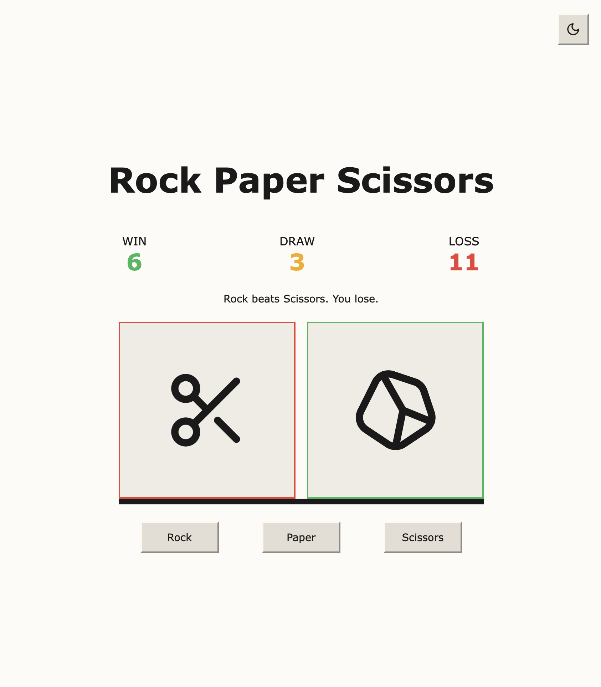
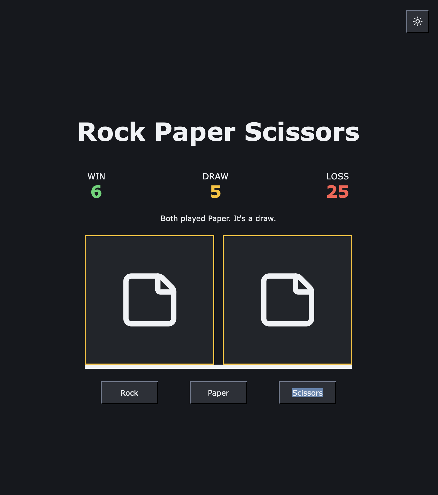

# rps-bot

A very simple Rock Paper Scissors web application for **single player**, where the bot attempts to predict your next move. 

## Features: 
- Light and dark mode toggle!
- Bot that attempts to predict your move using a **first-order markov chain**
- Tracks session results

## Screenshots:

  
  

## Demo <a href="https://brendanttang.github.io/rps-bot/">here</a>

>This repository also contains a python port of the bot, which was used for testing its accuracy against real player datasets. 
